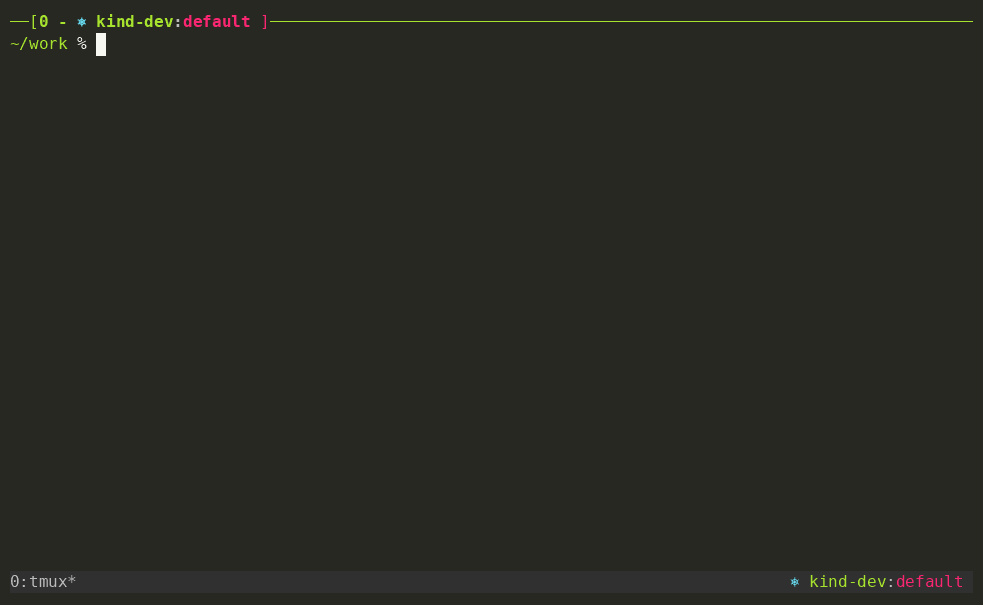

# tmux-ktx

* The goal of this repository is to have a Tmux plugin that display current kube context & namespace based on the active Tmux pane/window.
* Sometimes I can have `kubectl watch` running in a pane, so I want to "see" what is my current context and namespace used.
* It doesn't matter if user uses a single .kube/config or multiple and uses `KUBECONFIG` to point to the correct config, it should not error.
* Even if there are alternatives, I wanted to give it a try and see how I would do it.



Terminal replay of the same demo: `asciinema play docs/demo.cast`
(re-record with `make demo`).

## Why this repository

* Mostly educational purpose. I want to "play" with:
  * Creating a tmux plugin that is also useful in my setup (tmux + kube contexts)
  * GitHub Projects
  * Issues linked to projects
  * ISSUE_TEMPLATE
  * Having fun learning new stuff!

## Requirements

* tmux
* Go 1.26+ (only to build from source)

## Install

Download the archive for your OS and architecture (linux or darwin, amd64 or
arm64) from the [latest release](https://github.com/icadariu/tmux-ktx/releases/latest),
check it against `checksums.txt`, and put `tmux-ktx` somewhere tmux can run it
by absolute path. Or build from source as below.

## Build & Install

Build a local binary in the repo root:

```bash
make build
```

Install into your Go bin directory (`$GOBIN`, or `$(go env GOPATH)/bin` if `GOBIN` is unset):

```bash
make install
```

Make sure that directory is on your `$PATH`. Override defaults if needed:

```bash
make install LDFLAGS='-s -w' GOFLAGS='-trimpath'
```

Other targets: `make test`, `make fmt`, `make vet`, `make clean`, `make demo` (re-records the README demo; needs asciinema >= 3, agg, zsh, kubectl).

## Updating

Dependabot opens PRs that bump Go modules and GitHub Actions in this repo. Once those PRs merge into `main`, refresh your local binary:

```bash
git pull --ff-only
make install
```

This rebuilds `tmux-ktx` against the latest merged module versions and replaces the binary in `$(go env GOPATH)/bin`.

## How it works

```text
export KUBECONFIG=~/.kube/prod.yaml   ← you run this in a pane
        │
        ▼
zsh precmd hook (fires after every prompt)
  tmux set-option -p @ktx_kubeconfig "${KUBECONFIG:-$HOME/.kube/config}"
        │  stores the value as a per-pane tmux option
        ▼
tmux status-right / pane-border-format
  #(myPath/tmux-ktx #{q:@ktx_kubeconfig})
        │  tmux expands #{q:@ktx_kubeconfig} per pane, then calls the binary
        ▼
tmux-ktx binary
  reads the kubeconfig file → extracts current-context + namespace
  prints: #[fg=blue]⎈ #[fg=green]prod#[fg=colour250]:#[fg=red]default
        │
        ▼
pane border + status bar show:  ⎈ prod:default
```

**Why the shell hook is needed:** tmux runs `status-right` commands in the tmux server's
own environment, which is a snapshot from when the tmux session started. Variables you
`export` interactively inside a pane exist only in that shell's memory — the tmux server
never sees them. The hook bridges this gap by writing the current value of `KUBECONFIG`
into a tmux pane option after every prompt, which tmux can then read and pass to the binary.

**How fast does it update?** The pane option is updated immediately after each prompt (as
soon as you press Enter and get a new prompt back). The display itself refreshes on the
`status-interval` (every 5–10 seconds). In practice you will see the new context within
a few seconds of running any command.

## Shell Integration

Add the following one-liner to your `~/.zshrc`:

```zsh
# tmux-ktx: keep pane option in sync with KUBECONFIG
_tmux_ktx_hook() {
  [[ -z "$TMUX" ]] && return
  # Write on every prompt: a nested shell (kubie, zsh) may have changed the
  # option. Unset or empty KUBECONFIG means kubectl reads ~/.kube/config.
  tmux set-option -p @ktx_kubeconfig "${KUBECONFIG:-$HOME/.kube/config}" 2>/dev/null
}
precmd_functions+=(_tmux_ktx_hook)
```

## Usage

Add the following to your `.tmux.conf`:

```bash
# pane border (per-pane context)
set -g pane-border-status top
set -g pane-border-format "[#{?pane_active,#[bold],}#P - #(myPath/tmux-ktx -ctx-color green -ns-color red #{q:@ktx_kubeconfig}) #[nobold]]"

# status bar right (active pane context)
set -g status-right "#(myPath/tmux-ktx -ctx-color green -ns-color red #{q:@ktx_kubeconfig})"
set -g status-interval 5
```

> **Note:** Use the full path since tmux does not expand `~` or `$GOPATH` in shell command substitutions. If you installed via `make install`, the binary lives at `$(go env GOPATH)/bin/tmux-ktx` — substitute that absolute path for `myPath/tmux-ktx` above.

The plugin reads `KUBECONFIG` from the pane option set by the shell hook. If the option is
empty (the hook has not run in that pane, for example a window started straight into `k9s`),
it uses the `KUBECONFIG` that pane inherited from the tmux server, then `~/.kube/config`.
When no context is configured, nothing is displayed and the plugin exits cleanly.

Example output in the status bar:

```console
kind-kind:my-namespace
```

## Milestones

### 1. Functional go app (done)

* The plugin can:
  * Fetch current kube context based on `KUBECONFIG` (or fallback to `~/.kube/config`)
  * Fetch current namespace (defaults to `default` when not set)
  * Exits cleanly with no output when no context is defined
  * Output context + namespace formatted with tmux color codes:

    ```console
    #[fg=blue]⎈ #[fg=green]kind-kind#[fg=colour250]:#[fg=red]my-namespace
    ```

* Supports multiple kubeconfig files via colon-separated `KUBECONFIG` — contexts are merged, first `current-context` wins.

### 2. Release (done)

Released as [v0.1.1](https://github.com/icadariu/tmux-ktx/releases/tag/v0.1.1): prebuilt
binaries for linux and darwin (amd64, arm64) with checksums, published by CI from a signed
tag. New versions follow [RELEASING.md](RELEASING.md). No TPM packaging is required to use
it: install the binary, add the shell hook to `~/.zshrc` and the configuration to
`.tmux.conf`.

### 3. Improvements

* When creating a new pane, make sure to keep last context active in this newly created pane.
* Package as a proper tmux plugin (TPM-compatible entrypoint) for easier distribution.

## Credits

* This project was inspired by:
  * <https://github.com/jonmosco/kube-tmux>
  * <https://github.com/thecasualcoder/kube-tmuxp>
  * <https://github.com/uesyn/tmux-kubecontext>
  * <https://github.com/kr3cj/tmux-kube>
* How tmux-ktx compares with them: [docs/alternatives.md](docs/alternatives.md).
